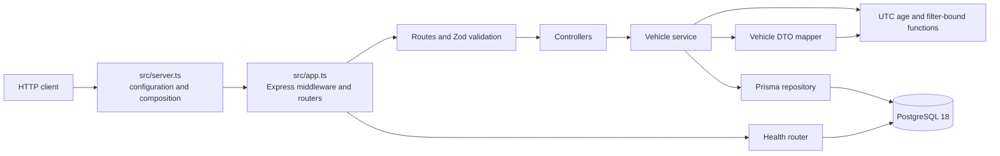

# Keyloop Inventory API

A TypeScript REST API for dealership vehicle inventory. It lists and filters
vehicles, derives aging-stock status, records a manager's proposed action, and
reports API/database health. The API has no frontend or authentication.

## Features

- Filtered, oldest-first vehicle listing with offset pagination.
- Vehicle details with age derived from UTC calendar dates.
- Replacement of a vehicle's proposed action and optional note.
- Structured validation/error responses, request IDs, and health checks.
- PostgreSQL-backed persistence with separate development and test databases.

## Prerequisites

- Node.js 24 LTS (the assessment baseline), npm, Docker Desktop, and Git.
- Docker Desktop must be running for the database and integration tests.

`package.json` currently declares `node >=22.13.0`; using Node 24 LTS is the
project's documented baseline. Use the committed `package-lock.json` with
`npm ci`.

## Quick start

Run the API from a fresh clone. The commands below assume the repository is
cloned into a folder named `keyloop-inventory-api`.

### macOS/Linux (bash)

```sh
git clone --branch feature/copilot-build https://github.com/AnhThong1503/keyloop-inventory-api.git
cd keyloop-inventory-api
npm ci
test -f .env || cp .env.example .env
docker compose up -d --wait
npm run db:deploy
npm run db:seed
npm run dev
```

### Windows PowerShell

```powershell
git clone --branch feature/copilot-build https://github.com/AnhThong1503/keyloop-inventory-api.git
Set-Location keyloop-inventory-api
npm ci
if (-not (Test-Path .env)) { Copy-Item .env.example .env }
docker compose up -d --wait
npm run db:deploy
npm run db:seed
npm run dev
```

The `.env` copy is conditional so rerunning the setup does not overwrite local
settings. Keep `.env` private; it is ignored by Git. Leave `npm run dev`
running in that terminal. In a second terminal, check the service:

```sh
curl -i http://127.0.0.1:3000/health
```

```powershell
curl.exe -i http://127.0.0.1:3000/health
```

A healthy response is HTTP 200 with `status: "ok"` and
`checks.database: "up"`.

## Interactive API Documentation

Start the backend and open [http://127.0.0.1:3000/docs](http://127.0.0.1:3000/docs).
For a local setup, run the database and seed commands from the repository root,
then start the development server:

```powershell
docker compose up -d --wait
npm run db:deploy
npm run db:seed
npm run dev
```

Scalar groups the documented endpoints by tag. Expand an operation to inspect
its parameters, request body, response schemas, status codes, and examples.
Use the built-in API client to send requests to the local development server
declared in the OpenAPI document.

The reference loads the existing
[OpenAPI YAML file](docs/openapi.yaml), which is also available at
[http://127.0.0.1:3000/openapi.yaml](http://127.0.0.1:3000/openapi.yaml).
It is the single source of truth for the displayed API contract.

## Environment variables

The app loads `.env` with dotenv and validates its configuration at startup.
Docker Compose also reads its variables from `.env`.

| Variable             | Required/default           | Purpose                                                                        |
| -------------------- | -------------------------- | ------------------------------------------------------------------------------ |
| `DATABASE_URL`       | Required                   | PostgreSQL URL for the API, Prisma CLI, and development seed.                  |
| `NODE_ENV`           | `development`              | Application mode: `development`, `test`, or `production`.                      |
| `PORT`               | `3000`                     | HTTP port, integer from 1 through 65535.                                       |
| `LOG_LEVEL`          | `info`                     | Pino level: `fatal`, `error`, `warn`, `info`, `debug`, `trace`, or `silent`.   |
| `POSTGRES_USER`      | `inventory` in Compose     | PostgreSQL container user.                                                     |
| `POSTGRES_PASSWORD`  | Local Compose default      | PostgreSQL container password; set a private local value as needed.            |
| `POSTGRES_DB`        | `inventory_dev` in Compose | Development database name.                                                     |
| `POSTGRES_PORT`      | `5432`                     | Host port for the development PostgreSQL container.                            |
| `POSTGRES_TEST_PORT` | `5433`                     | Host port for the test PostgreSQL container.                                   |
| `TEST_DATABASE_URL`  | Test helper default        | Optional integration-test URL override; its database name must end in `_test`. |

Use `127.0.0.1` in PostgreSQL URLs. Do not copy credentials into source,
documentation, logs, or issue reports.

## Database and migrations

Docker Compose starts PostgreSQL 18:

- `db`: development database `inventory_dev` on `127.0.0.1:5432`, persisted in
  the `postgres-data` volume at `/var/lib/postgresql`.
- `db-test`: `inventory_test` on `127.0.0.1:5433`, using container tmpfs
  rather than a persistent volume.

`npm run db:deploy` applies committed migrations and is suitable for the
quick-start setup. `npm run db:migrate` runs Prisma's development migration
workflow. `npm run db:generate` generates the Prisma client. Prisma 7 does not
automatically apply migrations or seed data; run those commands explicitly.

## Seeding

`npm run db:seed` upserts two dealerships and fourteen vehicles. The seeded
inventory dates are calculated relative to the UTC day when the seed runs, so
the absolute dates and displayed ages change from day to day. Rerunning the
seed restores its known vehicle actions and notes.

| Dealership ID                          | Name                 |
| -------------------------------------- | -------------------- |
| `a0000000-0000-4000-8000-000000000001` | Downtown Motors      |
| `a0000000-0000-4000-8000-000000000002` | Riverside Auto Group |

The vehicle inventory below lists each seed's relative age and initial
proposed action. Vehicle IDs use a 12-digit zero-padded sequence from
`...000000000001` through `...000000000014`.

| VIN suffix  | Vehicle                  | Dealership           | Days before seed day | Initial action            |
| ----------- | ------------------------ | -------------------- | -------------------: | ------------------------- |
| `000000001` | Kia Sportage (2021)      | Riverside Auto Group |                    0 | `NONE`                    |
| `000000002` | Toyota Corolla (2024)    | Downtown Motors      |                   12 | `NONE`                    |
| `000000003` | Mazda CX-5 (2023)        | Riverside Auto Group |                   30 | `NONE`                    |
| `000000004` | Toyota Corolla (2023)    | Downtown Motors      |                   45 | `NONE`                    |
| `000000005` | BMW 3 Series (2022)      | Downtown Motors      |                   60 | `NONE`                    |
| `000000006` | Ford Kuga (2022)         | Riverside Auto Group |                   75 | `NONE`                    |
| `000000007` | Toyota RAV4 (2023)       | Downtown Motors      |                   89 | `NONE`                    |
| `000000008` | Honda Civic (2022)       | Downtown Motors      |                   90 | `NONE`                    |
| `000000009` | Honda CR-V (2022)        | Downtown Motors      |                   91 | `UNDER_REVIEW`            |
| `000000010` | Hyundai Tucson (2022)    | Downtown Motors      |                   92 | `NONE`                    |
| `000000011` | Ford Focus (2021)        | Riverside Auto Group |                  120 | `PRICE_REDUCTION_PLANNED` |
| `000000012` | Volkswagen Golf (2021)   | Riverside Auto Group |                  150 | `PROMOTION_PLANNED`       |
| `000000013` | Volkswagen Tiguan (2020) | Riverside Auto Group |                  210 | `WHOLESALE_PLANNED`       |
| `000000014` | BMW X1 (2021)            | Downtown Motors      |                  365 | `TRANSFER_PLANNED`        |

## Running the API and trying requests

`npm run dev` starts the development server on port 3000. Use the complete
request examples and captured responses in
[docs/api-examples.md](docs/api-examples.md). The machine-readable contract is
[docs/openapi.yaml](docs/openapi.yaml), and it can be checked with
`npm run openapi:lint`.

| Method and path                   | Purpose                                                                                                                                                    | Success | Main errors             |
| --------------------------------- | ---------------------------------------------------------------------------------------------------------------------------------------------------------- | ------- | ----------------------- |
| `GET /api/vehicles`               | List/filter vehicles. Query parameters: `make`, `model`, `dealershipId`, `aging`, `minAgeDays`, `maxAgeDays`, `page` (default 1), `pageSize` (default 20). | 200     | 400, 413, 500, 503      |
| `GET /api/vehicles/{id}`          | Return one vehicle by UUID.                                                                                                                                | 200     | 400, 404, 413, 500, 503 |
| `PATCH /api/vehicles/{id}/action` | Replace a vehicle's action and optional note.                                                                                                              | 200     | 400, 404, 413, 500, 503 |
| `GET /health`                     | Check API and database availability.                                                                                                                       | 200     | 400, 413, 503           |

`VALIDATION_ERROR` and `INVALID_JSON` are 400 errors; `VEHICLE_NOT_FOUND` and
`ROUTE_NOT_FOUND` are 404; `PAYLOAD_TOO_LARGE` is 413; `INTERNAL_ERROR` is
500; and `SERVICE_UNAVAILABLE` is 503. The shared error envelope includes a
request ID; see the OpenAPI contract for response details.

### Aging rule

`ageInDays` is the number of whole UTC calendar days since `inventoryDate`, floored at zero.
`isAgingStock` is true only when `ageInDays > 90`; a 90-day vehicle is not aging.
Aging is calculated for responses and filters; it is not stored in PostgreSQL.

## Tests and quality checks

Run tests from the repository root. Unit tests use fake repositories and do
not access a database. Integration tests use `inventory_test` on port 5433
and refuse a URL whose database name does not end with `_test`.

| Purpose                                                  | Command                    |
| -------------------------------------------------------- | -------------------------- |
| Unit tests                                               | `npm run test:unit`        |
| Integration tests                                        | `npm run test:integration` |
| Both test projects                                       | `npm test`                 |
| Coverage (V8; domain and service line/branch thresholds) | `npm run test:coverage`    |
| TypeScript check                                         | `npm run typecheck`        |
| ESLint                                                   | `npm run lint`             |
| Prettier verification                                    | `npm run format:check`     |
| Production build                                         | `npm run build`            |
| Combined format, lint, typecheck, test, and build check  | `npm run check`            |
| OpenAPI lint                                             | `npm run openapi:lint`     |

The tests use `TEST_TZ` (UTC by default) to verify behavior across time zones.
See [docs/testing.md](docs/testing.md) for the time-zone commands, test
database isolation details, coverage policy, and requirement-to-test trace.

`npm run build` generates the Prisma client and compiles TypeScript to
`dist/`; `npm start` serves the compiled `dist/server.js`.

## Architecture

The application is a modular monolith. `src/app.ts` composes Express and
injectable dependencies without listening; `src/server.ts` validates
configuration, creates Prisma/logger/clock dependencies, starts the HTTP
server, and handles graceful shutdown.



## Project structure

```text
src/
  app.ts                 Express app factory
  server.ts              runtime composition and graceful shutdown
  config/                environment parsing
  db/                    Prisma client setup
  modules/health/        database health endpoint
  modules/vehicles/      routes, schemas, controllers, service, repository, mapper
    domain/              pure UTC age and aging-range functions
  shared/                clock, errors, logging, request ID, validation
prisma/
  schema.prisma          data model and enum
  migrations/            committed SQL migrations
  seed.ts                repeatable demo data
tests/
  unit/                  pure logic and isolated application behavior
  integration/           API/database behavior against the test database
docs/                    design, API, test, and collaboration documentation
  ai-workflow/           setup guidance, orchestration, and assessment references
.github/
  copilot-instructions.md Copilot entrypoint
  prompts/               the eleven implementation prompts, in order
```

## Version pins and compatibility

The source plan fixes these major versions; `package-lock.json` records the
resolved dependency versions used by `npm ci`.

| Component                          | Project version | Rationale                                                                 |
| ---------------------------------- | --------------- | ------------------------------------------------------------------------- |
| Node.js                            | 24 LTS baseline | Required runtime baseline in the design brief.                            |
| TypeScript                         | 6               | TypeScript 7 is excluded because `typescript-eslint` cannot use it yet.   |
| Express                            | 5               | Required API framework major.                                             |
| Prisma, client, PostgreSQL adapter | 7               | Prisma 8 is a release candidate and an unpinned install may select it.    |
| PostgreSQL                         | 18              | Compose image major; its data volume is mounted at `/var/lib/postgresql`. |
| Zod                                | 4               | Required validation major.                                                |
| Vitest                             | 4               | Required test-runner major.                                               |
| ESLint                             | 10              | Required flat-config lint major.                                          |
| Prettier                           | 3               | Formatting is run separately from ESLint.                                 |

The package manifest uses major-scoped semver ranges for dependencies and
`npm ci` follows the lockfile. The Node engine range in `package.json` is
`>=22.13.0`, broader than the documented Node 24 baseline.

## Known limitations

- There is no authentication or authorization.
- Age boundaries use UTC calendar days, not dealership-local time zones.
- Pagination is offset-based; concurrent changes can shift later pages.
- Case-insensitive make/model filters have no dedicated indexes.
- Proposed actions are last-write-wins; there is no audit history.
- The API process is run directly by npm rather than in a Compose service.

## Troubleshooting

1. **Database connection refused:** start Docker Desktop, then run
   `docker compose up -d --wait`. Keep the development URL on port 5432.
2. **Missing migration/table:** run `npm run db:deploy`, then
   `npm run db:seed`.
3. **Prisma client cannot be imported:** run `npm ci` or `npm run db:generate`.
4. **Integration tests reject the database URL:** use the test service on port
   5433 and a database name ending in `_test`; never point tests at `inventory_dev`.
5. **Port 3000 is already in use:** stop the other local server or set a free
   `PORT` in `.env`.
6. **Configuration validation fails:** check that `DATABASE_URL` is a valid
   PostgreSQL URL and that `PORT`, `NODE_ENV`, and `LOG_LEVEL` use accepted values.

## AI Collaboration Narrative

### How AI was used

I got the design and 11-prompt implementation plan as a PDF from Claude. I
gave that PDF to ChatGPT, which turned it into a starter pack for GitHub
Copilot: `AGENTS.md`, a master prompt, 11 prompt files, and supporting
documentation. The pack's
[notes](docs/ai-workflow/PACKAGE-NOTES.md) describe changes made while
transferring the plan, including repairs to PDF-extracted text.

I ran P01 through P11 with GitHub Copilot in VS Code Agent mode on
`feature/copilot-build`, then used a cleanup and refactor prompt for P12. I
used the default Agent mode model; I do not have a model name to report.
Copilot produced the implementation, tests, and project documentation in the
checkpoint commits. I did not hand-edit files.

The prompts included unit and integration test work, boundary tests, mutation
checks, coverage, and build gates. The collaboration log records those
checkpoint results. I did not personally run or watch the listed tests,
curl/Postman requests, mutation check, build/start, or clean-clone run. I
mostly read the final results rather than the diffs. The P07 and P09 log
entries record test/command retries during agent work; I did not personally
encounter those problems, and I did not notice a separate AI error.

P12 was a cleanup and refactor pass. Its commits moved workflow references,
removed two empty placeholders and four unreferenced schema types, and fixed
a date-format typo in the design brief. It did not change product behavior.

### How I verified generated code

I did not personally run or watch verification during this work, so I do not
present the checkpoint results as my own runs. The checkpoint log records the
commands and outcomes for each phase. On 2026-11-03, `npm run check` was
re-run in this workspace: formatting, lint, typecheck, 12 test files with
186 tests, and the build passed. That is a current workspace result, not a
claim that I ran it myself. I still need to review the implementation and
understand the parts I plan to maintain.

### Meaningful decisions and corrections

I did not notice an AI error or identify a broader scope or trade-off
decision. The earlier log records my setup choices for the sample database
URLs. The repository also records changes made during the work; these are not
claims that I directed or noticed them at the time.

| Repository-recorded change                                                                                     | Evidence                                                                                              |
| -------------------------------------------------------------------------------------------------------------- | ----------------------------------------------------------------------------------------------------- |
| The starter pack adapted the source plan and records repairs to extracted schema and URL text.                 | [docs/ai-workflow/PACKAGE-NOTES.md](docs/ai-workflow/PACKAGE-NOTES.md); starter-pack commit `f69af97` |
| P11 updated the README clone branch and corrected age-filter descriptions in the OpenAPI and design documents. | P11 commit `5d460c4`; P11 section in [`docs/ai-collaboration-log.md`](docs/ai-collaboration-log.md)   |
| P12 corrected the design-brief date format and removed four unused schema type exports.                        | Commits `7fdd3d4` and `a6ad94c`                                                                       |

### How I retained ownership of the final implementation

I did not make hand edits, and I mostly read final results rather than diffs.
I cannot claim a level of code review that I did not do. The repository
contains the API, database, test, and documentation checkpoints, but I need
to review those details myself before saying which parts I can maintain. I
am responsible for the project I submit, including understanding and checking
the implementation.

### What I would do differently

`TODO(user): What would you change about your process or use of AI next time?`

Note: this section was drafted with AI assistance from my commit history, prompt log and my own answers.
