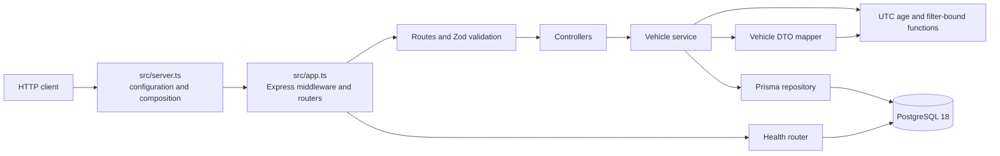

# Keyloop Inventory API

A TypeScript REST API for dealership vehicle inventory. It lists and filters
vehicles, derives aging-stock status, records a manager's proposed action, and
reports API/database health. The API has no frontend or authentication.

## Features

- Filtered, oldest-first vehicle listing with offset pagination.
- Vehicle details with age derived from UTC calendar dates.
- Replacement of a vehicle's proposed action and optional note.
- Structured validation/error responses, request IDs, and health checks.
- PostgreSQL-backed persistence with separate development and test databases.

## Prerequisites

- Node.js 24 LTS (the assessment baseline), npm, Docker Desktop, and Git.
- Docker Desktop must be running for the database and integration tests.

`package.json` currently declares `node >=22.13.0`; using Node 24 LTS is the
project's documented baseline. Use the committed `package-lock.json` with
`npm ci`.

## Quick start

Run the API from a fresh clone. The commands below assume the repository is
cloned into a folder named `keyloop-inventory-api`.

### macOS/Linux (bash)

```sh
git clone --branch feature/copilot-build https://github.com/AnhThong1503/keyloop-inventory-api.git
cd keyloop-inventory-api
npm ci
test -f .env || cp .env.example .env
docker compose up -d --wait
npm run db:deploy
npm run db:seed
npm run dev
```

### Windows PowerShell

```powershell
git clone --branch feature/copilot-build https://github.com/AnhThong1503/keyloop-inventory-api.git
Set-Location keyloop-inventory-api
npm ci
if (-not (Test-Path .env)) { Copy-Item .env.example .env }
docker compose up -d --wait
npm run db:deploy
npm run db:seed
npm run dev
```

The `.env` copy is conditional so rerunning the setup does not overwrite local
settings. Keep `.env` private; it is ignored by Git. Leave `npm run dev`
running in that terminal. In a second terminal, check the service:

```sh
curl -i http://127.0.0.1:3000/health
```

```powershell
curl.exe -i http://127.0.0.1:3000/health
```

A healthy response is HTTP 200 with `status: "ok"` and
`checks.database: "up"`.

## Environment variables

The app loads `.env` with dotenv and validates its configuration at startup.
Docker Compose also reads its variables from `.env`.

| Variable             | Required/default           | Purpose                                                                        |
| -------------------- | -------------------------- | ------------------------------------------------------------------------------ |
| `DATABASE_URL`       | Required                   | PostgreSQL URL for the API, Prisma CLI, and development seed.                  |
| `NODE_ENV`           | `development`              | Application mode: `development`, `test`, or `production`.                      |
| `PORT`               | `3000`                     | HTTP port, integer from 1 through 65535.                                       |
| `LOG_LEVEL`          | `info`                     | Pino level: `fatal`, `error`, `warn`, `info`, `debug`, `trace`, or `silent`.   |
| `POSTGRES_USER`      | `inventory` in Compose     | PostgreSQL container user.                                                     |
| `POSTGRES_PASSWORD`  | Local Compose default      | PostgreSQL container password; set a private local value as needed.            |
| `POSTGRES_DB`        | `inventory_dev` in Compose | Development database name.                                                     |
| `POSTGRES_PORT`      | `5432`                     | Host port for the development PostgreSQL container.                            |
| `POSTGRES_TEST_PORT` | `5433`                     | Host port for the test PostgreSQL container.                                   |
| `TEST_DATABASE_URL`  | Test helper default        | Optional integration-test URL override; its database name must end in `_test`. |

Use `127.0.0.1` in PostgreSQL URLs. Do not copy credentials into source,
documentation, logs, or issue reports.

## Database and migrations

Docker Compose starts PostgreSQL 18:

- `db`: development database `inventory_dev` on `127.0.0.1:5432`, persisted in
  the `postgres-data` volume at `/var/lib/postgresql`.
- `db-test`: `inventory_test` on `127.0.0.1:5433`, using container tmpfs
  rather than a persistent volume.

`npm run db:deploy` applies committed migrations and is suitable for the
quick-start setup. `npm run db:migrate` runs Prisma's development migration
workflow. `npm run db:generate` generates the Prisma client. Prisma 7 does not
automatically apply migrations or seed data; run those commands explicitly.

## Seeding

`npm run db:seed` upserts two dealerships and fourteen vehicles. The seeded
inventory dates are calculated relative to the UTC day when the seed runs, so
the absolute dates and displayed ages change from day to day. Rerunning the
seed restores its known vehicle actions and notes.

| Dealership ID                          | Name                 |
| -------------------------------------- | -------------------- |
| `a0000000-0000-4000-8000-000000000001` | Downtown Motors      |
| `a0000000-0000-4000-8000-000000000002` | Riverside Auto Group |

The vehicle inventory below lists each seed's relative age and initial
proposed action. Vehicle IDs use a 12-digit zero-padded sequence from
`...000000000001` through `...000000000014`.

| VIN suffix  | Vehicle                  | Dealership           | Days before seed day | Initial action            |
| ----------- | ------------------------ | -------------------- | -------------------: | ------------------------- |
| `000000001` | Kia Sportage (2021)      | Riverside Auto Group |                    0 | `NONE`                    |
| `000000002` | Toyota Corolla (2024)    | Downtown Motors      |                   12 | `NONE`                    |
| `000000003` | Mazda CX-5 (2023)        | Riverside Auto Group |                   30 | `NONE`                    |
| `000000004` | Toyota Corolla (2023)    | Downtown Motors      |                   45 | `NONE`                    |
| `000000005` | BMW 3 Series (2022)      | Downtown Motors      |                   60 | `NONE`                    |
| `000000006` | Ford Kuga (2022)         | Riverside Auto Group |                   75 | `NONE`                    |
| `000000007` | Toyota RAV4 (2023)       | Downtown Motors      |                   89 | `NONE`                    |
| `000000008` | Honda Civic (2022)       | Downtown Motors      |                   90 | `NONE`                    |
| `000000009` | Honda CR-V (2022)        | Downtown Motors      |                   91 | `UNDER_REVIEW`            |
| `000000010` | Hyundai Tucson (2022)    | Downtown Motors      |                   92 | `NONE`                    |
| `000000011` | Ford Focus (2021)        | Riverside Auto Group |                  120 | `PRICE_REDUCTION_PLANNED` |
| `000000012` | Volkswagen Golf (2021)   | Riverside Auto Group |                  150 | `PROMOTION_PLANNED`       |
| `000000013` | Volkswagen Tiguan (2020) | Riverside Auto Group |                  210 | `WHOLESALE_PLANNED`       |
| `000000014` | BMW X1 (2021)            | Downtown Motors      |                  365 | `TRANSFER_PLANNED`        |

## Running the API and trying requests

`npm run dev` starts the development server on port 3000. Use the complete
request examples and captured responses in
[docs/api-examples.md](docs/api-examples.md). The machine-readable contract is
[docs/openapi.yaml](docs/openapi.yaml), and it can be checked with
`npm run openapi:lint`.

| Method and path                   | Purpose                                                                                                                                                    | Success | Main errors             |
| --------------------------------- | ---------------------------------------------------------------------------------------------------------------------------------------------------------- | ------- | ----------------------- |
| `GET /api/vehicles`               | List/filter vehicles. Query parameters: `make`, `model`, `dealershipId`, `aging`, `minAgeDays`, `maxAgeDays`, `page` (default 1), `pageSize` (default 20). | 200     | 400, 413, 500, 503      |
| `GET /api/vehicles/{id}`          | Return one vehicle by UUID.                                                                                                                                | 200     | 400, 404, 413, 500, 503 |
| `PATCH /api/vehicles/{id}/action` | Replace a vehicle's action and optional note.                                                                                                              | 200     | 400, 404, 413, 500, 503 |
| `GET /health`                     | Check API and database availability.                                                                                                                       | 200     | 400, 413, 503           |

`VALIDATION_ERROR` and `INVALID_JSON` are 400 errors; `VEHICLE_NOT_FOUND` and
`ROUTE_NOT_FOUND` are 404; `PAYLOAD_TOO_LARGE` is 413; `INTERNAL_ERROR` is
500; and `SERVICE_UNAVAILABLE` is 503. The shared error envelope includes a
request ID; see the OpenAPI contract for response details.

### Aging rule

`ageInDays` is the number of whole UTC calendar days since `inventoryDate`, floored at zero.
`isAgingStock` is true only when `ageInDays > 90`; a 90-day vehicle is not aging.
Aging is calculated for responses and filters; it is not stored in PostgreSQL.

## Tests and quality checks

Run tests from the repository root. Unit tests use fake repositories and do
not access a database. Integration tests use `inventory_test` on port 5433
and refuse a URL whose database name does not end with `_test`.

| Purpose                                                  | Command                    |
| -------------------------------------------------------- | -------------------------- |
| Unit tests                                               | `npm run test:unit`        |
| Integration tests                                        | `npm run test:integration` |
| Both test projects                                       | `npm test`                 |
| Coverage (V8; domain and service line/branch thresholds) | `npm run test:coverage`    |
| TypeScript check                                         | `npm run typecheck`        |
| ESLint                                                   | `npm run lint`             |
| Prettier verification                                    | `npm run format:check`     |
| Production build                                         | `npm run build`            |
| Combined format, lint, typecheck, test, and build check  | `npm run check`            |
| OpenAPI lint                                             | `npm run openapi:lint`     |

The tests use `TEST_TZ` (UTC by default) to verify behavior across time zones.
See [docs/testing.md](docs/testing.md) for the time-zone commands, test
database isolation details, coverage policy, and requirement-to-test trace.

`npm run build` generates the Prisma client and compiles TypeScript to
`dist/`; `npm start` serves the compiled `dist/server.js`.

## Architecture

The application is a modular monolith. `src/app.ts` composes Express and
injectable dependencies without listening; `src/server.ts` validates
configuration, creates Prisma/logger/clock dependencies, starts the HTTP
server, and handles graceful shutdown.



## Project structure

```text
src/
  app.ts                 Express app factory
  server.ts              runtime composition and graceful shutdown
  config/                environment parsing
  db/                    Prisma client setup
  modules/health/        database health endpoint
  modules/vehicles/      routes, schemas, controllers, service, repository, mapper
    domain/              pure UTC age and aging-range functions
  shared/                clock, errors, logging, request ID, validation
prisma/
  schema.prisma          data model and enum
  migrations/            committed SQL migrations
  seed.ts                repeatable demo data
tests/
  unit/                  pure logic and isolated application behavior
  integration/           API/database behavior against the test database
docs/                    design, API, test, and collaboration documentation
```

## Version pins and compatibility

The source plan fixes these major versions; `package-lock.json` records the
resolved dependency versions used by `npm ci`.

| Component                          | Project version | Rationale                                                                 |
| ---------------------------------- | --------------- | ------------------------------------------------------------------------- |
| Node.js                            | 24 LTS baseline | Required runtime baseline in the design brief.                            |
| TypeScript                         | 6               | TypeScript 7 is excluded because `typescript-eslint` cannot use it yet.   |
| Express                            | 5               | Required API framework major.                                             |
| Prisma, client, PostgreSQL adapter | 7               | Prisma 8 is a release candidate and an unpinned install may select it.    |
| PostgreSQL                         | 18              | Compose image major; its data volume is mounted at `/var/lib/postgresql`. |
| Zod                                | 4               | Required validation major.                                                |
| Vitest                             | 4               | Required test-runner major.                                               |
| ESLint                             | 10              | Required flat-config lint major.                                          |
| Prettier                           | 3               | Formatting is run separately from ESLint.                                 |

The package manifest uses major-scoped semver ranges for dependencies and
`npm ci` follows the lockfile. The Node engine range in `package.json` is
`>=22.13.0`, broader than the documented Node 24 baseline.

## Known limitations

- There is no authentication or authorization.
- Age boundaries use UTC calendar days, not dealership-local time zones.
- Pagination is offset-based; concurrent changes can shift later pages.
- Case-insensitive make/model filters have no dedicated indexes.
- Proposed actions are last-write-wins; there is no audit history.
- The API process is run directly by npm rather than in a Compose service.

## Troubleshooting

1. **Database connection refused:** start Docker Desktop, then run
   `docker compose up -d --wait`. Keep the development URL on port 5432.
2. **Missing migration/table:** run `npm run db:deploy`, then
   `npm run db:seed`.
3. **Prisma client cannot be imported:** run `npm ci` or `npm run db:generate`.
4. **Integration tests reject the database URL:** use the test service on port
   5433 and a database name ending in `_test`; never point tests at `inventory_dev`.
5. **Port 3000 is already in use:** stop the other local server or set a free
   `PORT` in `.env`.
6. **Configuration validation fails:** check that `DATABASE_URL` is a valid
   PostgreSQL URL and that `PORT`, `NODE_ENV`, and `LOG_LEVEL` use accepted values.

## AI Collaboration Narrative

Complete this narrative yourself from the factual entries in
[docs/ai-collaboration-log.md](docs/ai-collaboration-log.md). Do not treat
these prompts as claims about your experience.

### How AI was used

- **Planning:** Which planning work did AI assist with? `TODO(user): Describe your own experience.`
- **Implementation:** Which implementation tasks did AI assist with? `TODO(user): Describe your own experience.`
- **Testing:** How did AI contribute to test design or execution? `TODO(user): Describe your own experience.`
- **Debugging:** Which debugging work, if any, involved AI? `TODO(user): Describe your own experience.`
- **Refinement:** How did you refine the result? `TODO(user): Describe your own experience.`

### How I verified generated code

- What did you inspect or run before accepting generated work? `TODO(user): Answer with your own verification process.`
- Which checks most influenced your confidence? `TODO(user): Name the checks and why.`

### Meaningful decisions and corrections

- Decision/correction 1 — [P01 log row](docs/ai-collaboration-log.md#2026-11-03--p01): `TODO(user): What was the decision or correction, and why?`
- Decision/correction 2 — [P08 log row](docs/ai-collaboration-log.md#2026-11-03--p08): `TODO(user): What was the decision or correction, and why?`
- Decision/correction 3 — [P09 log row](docs/ai-collaboration-log.md#2026-11-03--p09): `TODO(user): What was the decision or correction, and why?`

### How I retained ownership of the final implementation

- What did you personally review, change, or approve? `TODO(user): Describe only what you did.`
- Which parts do you understand well enough to explain or maintain? `TODO(user): Describe your own understanding.`

### What I would do differently

- What would you change about your process or use of AI next time? `TODO(user): Answer from your own perspective.`
