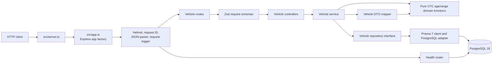
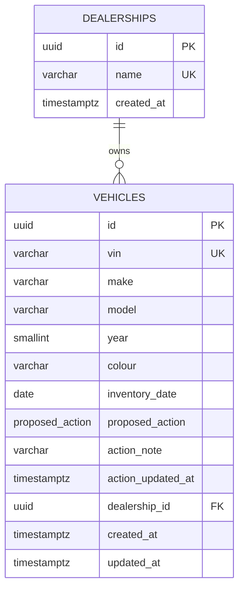

# System design

## Problem statement

The service provides a dealership group with a single API for viewing vehicle
inventory, identifying stock held for more than 90 days, and recording a
proposed action for a vehicle. It exposes a health check for the API's
PostgreSQL dependency. A frontend is outside this repository's scope.

## Scope and assumptions

The design brief describes the required scope and behavior but does not label
assumptions A1–A15. This document therefore records only decisions visible in
the brief and implementation:

- One Express API and one PostgreSQL database, organized as a modular monolith.
- Dealerships own vehicles; each vehicle has exactly one dealership.
- Vehicle aging is based on whole UTC calendar days and a strict 90-day
  threshold.
- Actions are a single replaceable state per vehicle, not an event history.
- Development and integration-test databases are separate Compose services.
- Authentication, authorization, a frontend, queues, and caching are out of
  scope.

## Functional and non-functional requirements

### Functional

1. List vehicles, combine make/model/dealership/aging/age filters with AND,
   sort oldest first with an ID tie-break, and return page metadata.
2. Fetch one vehicle by UUID and return a standard 404 for an unknown vehicle.
3. Replace the proposed action and note for any vehicle; omitted, null, or
   blank notes clear the stored note.
4. Report database availability from `GET /health`.
5. Validate query, path, and body input and return a request-ID-bearing error
   envelope.

### Non-functional

- Keep UTC date arithmetic in pure domain functions and obtain current time
  through an injectable `Clock`.
- Keep HTTP composition separate from the listening server so tests can create
  the app without opening a port.
- Do not disclose credentials, request bodies, or stack traces to API clients.
- Keep integration tests isolated to a database whose name ends in `_test`;
  unit tests perform no database I/O.
- Use committed migrations and a repeatable seed for local demonstration.

## Architecture



## Component responsibilities

| Component                                  | Responsibility                                                                                                    |
| ------------------------------------------ | ----------------------------------------------------------------------------------------------------------------- |
| `src/server.ts`                            | Loads validated environment settings, creates logger/Prisma/system clock, listens, and handles graceful shutdown. |
| `src/app.ts`                               | Builds the Express application and middleware/router/error-handler chain; does not listen.                        |
| `src/modules/vehicles/vehicle.routes.ts`   | Maps list, detail, and action routes to controllers.                                                              |
| `vehicle.schemas.ts` and shared validation | Validates strict query, UUID parameter, and action-body inputs with Zod.                                          |
| `vehicle.controller.ts`                    | Validates requests, invokes service operations, and writes HTTP responses.                                        |
| `vehicle.service.ts`                       | Applies age filtering, coordinates the clock and repository, maps not-found cases, and builds list metadata.      |
| `domain/inventory-age.ts`                  | Implements UTC-day age, the `> 90` rule, age-range resolution, and inventory-date bounds without I/O.             |
| `vehicle.repository.ts`                    | Translates service filters to Prisma operations and loads dealership fields.                                      |
| `vehicle.mapper.ts`                        | Derives response age/status and maps database records into API vehicle DTOs.                                      |
| Health router                              | Runs `SELECT 1` with a two-second timeout and returns healthy/degraded status.                                    |
| Shared middleware                          | Provides request IDs, structured request logging, error mapping, and common error types.                          |
| Prisma schema/migrations/seed              | Define the PostgreSQL data model, schema changes, and repeatable demo records.                                    |

## Data model



`dealerships` has a UUID primary key, unique `name` (`varchar(100)`), and
`created_at`. `vehicles` has a UUID primary key; unique 17-character VIN;
make/model (`varchar(50)`); year (`smallint`); colour (`varchar(30)`); SQL
`DATE` inventory date; action enum, nullable note (`varchar(500)`) and update
timestamp; required dealership foreign key; and creation/update timestamps.
Database CHECK constraints require year 1980–2100 and a VIN length of 17. The
foreign key restricts dealership deletion and cascades key updates.

Unique indexes cover dealership name and vehicle VIN. Non-unique indexes cover
`vehicles.inventory_date` and `vehicles.dealership_id`. There are no
`is_aging`, make, or model columns/indexes.

## API design

The HTTP interface is defined in [openapi.yaml](./openapi.yaml).

| Method and path                   | Behavior                       | Success | Error statuses          |
| --------------------------------- | ------------------------------ | ------- | ----------------------- |
| `GET /api/vehicles`               | Filter and page the inventory. | 200     | 400, 413, 500, 503      |
| `GET /api/vehicles/{id}`          | Return one vehicle.            | 200     | 400, 404, 413, 500, 503 |
| `PATCH /api/vehicles/{id}/action` | Replace action and note.       | 200     | 400, 404, 413, 500, 503 |
| `GET /health`                     | Check the database dependency. | 200     | 400, 413, 503           |

List filters are `make`, `model`, `dealershipId`, `aging`, `minAgeDays`, and
`maxAgeDays`; pagination is `page` (default 1) and `pageSize` (default 20).
Unknown query fields and invalid values are rejected. The response contract
lists all error codes and envelope details.

## Data flow

### `GET /api/vehicles`

```mermaid
sequenceDiagram
  actor Client
  participant App as Express app
  participant Route as Vehicle route/controller
  participant Service as Vehicle service
  participant Clock
  participant Domain as Age/range functions
  participant Mapper as Vehicle DTO mapper
  participant Repository as Prisma repository
  participant DB as PostgreSQL
  Client->>App: GET /api/vehicles?filters
  App->>App: Assign request ID; parse and log request
  App->>Route: Match list route
  Route->>Route: Validate query with Zod
  Route->>Service: listVehicles(validated query)
  Service->>Clock: now()
  Service->>Domain: Resolve age range and date bounds
  Domain-->>Service: Inclusive UTC inventory-date bounds
  Service->>Repository: Find page and filtered count
  Repository->>DB: Transaction: ordered findMany + count
  DB-->>Repository: Vehicle rows and count
  Repository-->>Service: Records and total
  Service->>Mapper: Map each record to a DTO
  Mapper->>Domain: Derive age and aging flag
  Domain-->>Mapper: Age and status
  Mapper-->>Service: Mapped DTOs
  Service-->>Route: DTOs and pagination metadata
  Route-->>Client: 200 JSON response
  App->>App: Log response status and duration
```

### `PATCH /api/vehicles/:id/action`

```mermaid
sequenceDiagram
  actor Client
  participant App as Express app
  participant Route as Vehicle route/controller
  participant Service as Vehicle service
  participant Clock
  participant Repository as Prisma repository
  participant DB as PostgreSQL
  Client->>App: PATCH /api/vehicles/:id/action with JSON
  App->>App: Assign request ID; parse and log request
  App->>Route: Match action route
  Route->>Route: Validate UUID and strict action body
  Route->>Service: updateVehicleAction(id, body)
  Service->>Repository: Find current vehicle
  Repository->>DB: findUnique with dealership
  DB-->>Repository: Vehicle or no record
  Repository-->>Service: Existing record or null
  alt Vehicle does not exist
    Service-->>Route: VEHICLE_NOT_FOUND
    Route-->>Client: 404 error envelope
  else Vehicle exists
    Service->>Clock: now()
    Service->>Repository: Replace action, note, and timestamp
    Repository->>DB: Update vehicle and include dealership
    DB-->>Repository: Updated vehicle
    Repository-->>Service: Updated record
    Service-->>Route: Mapped vehicle DTO
    Route-->>Client: 200 JSON response
  end
```

## Business rules

### Age and UTC

`inventoryDate` is a SQL date. The mapper calculates whole UTC calendar days
from that date to the UTC day from the injected clock. Negative ages are
clamped to zero. `isAgingStock` is true only for `ageInDays > 90`, so 90 days
is false and 91 days is true. The flag is derived and is not persisted.

### Filters and pagination

- Filters are combined with AND. Make/model are trimmed and
  case-insensitive exact matches; dealership ID is a UUID.
- `aging=true` means age at least 91; `aging=false` means age at most 90.
- `minAgeDays`/`maxAgeDays` are inclusive integers from 0 to 36500, and the
  minimum cannot exceed the maximum. Contradictory combined ranges produce an
  empty 200 response.
- Age filters become inventory-date bounds calculated from the injected
  clock. SQL does not use `NOW()` or `CURRENT_DATE`.
- Pages start at 1; page size is 1–100. Results sort by inventory date
  ascending and then ID ascending. Pagination uses offset/limit semantics;
  `totalItems` counts the filtered set.

### Actions and errors

The six values are `NONE`, `UNDER_REVIEW`, `PRICE_REDUCTION_PLANNED`,
`PROMOTION_PLANNED`, `TRANSFER_PLANNED`, and `WHOLESALE_PLANNED`. Updates
replace action state for vehicles of any age. Omitted, null, or blank note
clears the note; `actionUpdatedAt` comes from the clock. Unknown vehicle IDs
produce `VEHICLE_NOT_FOUND`; malformed UUIDs are validation errors. The shared
handler maps malformed JSON, oversized bodies, recognized database
connectivity errors, and unexpected errors to their documented envelopes.

## Technology choices and compatibility

| Technology                |           Major | Repository-specific reason                                                                           |
| ------------------------- | --------------: | ---------------------------------------------------------------------------------------------------- |
| Node.js                   | 24 LTS baseline | Version required by the source plan. The manifest currently allows `>=22.13.0`.                      |
| TypeScript                |               6 | TypeScript 7 is not usable with the selected `typescript-eslint` version.                            |
| Express                   |               5 | Required API framework; async handler errors flow to the error middleware.                           |
| Prisma ORM/client/adapter |               7 | Prisma 8 is a release candidate; Prisma 7 uses the config-based datasource and generated client.     |
| PostgreSQL                |              18 | Required database major. The Compose volume uses `/var/lib/postgresql`, the PostgreSQL 18 data path. |
| Zod                       |               4 | Required schema-validation major.                                                                    |
| Vitest                    |               4 | Required test-runner major; integration files run serially.                                          |
| ESLint                    |              10 | Required flat-config lint major.                                                                     |
| Prettier                  |               3 | Formatting is checked separately, without `eslint-config-prettier`.                                  |

The dependency manifest uses major-scoped ranges; the lockfile records the
installable versions. Prisma client generation is run by `postinstall` and
`build`. Prisma 7 does not automatically migrate or seed the database.

## Error handling and observability

The app sets security headers with Helmet, assigns or validates `x-request-id`,
and returns that ID in the response header and error envelope. Pino logs method,
path without query string, status, duration, and request ID; server-side error
type and stack are logged for 5xx failures. Credentials, request bodies,
authorization/cookie headers, and stack traces are not sent in responses.

The health handler issues `SELECT 1` with a two-second timeout and returns
200/up or 503/degraded. The server handles SIGINT/SIGTERM by closing the HTTP
server and disconnecting Prisma, with a ten-second shutdown timeout.

## Security and maintainability

Helmet and strict Zod schemas reduce common HTTP/input risks, and database
credentials are read from ignored local environment configuration. There is
no authentication, authorization, rate limiting, or audit trail; the API
should be treated as a local/demo service, not an exposed production endpoint.
The app factory, injected clock, repository interface, and pure domain
functions support isolated unit and integration testing.

## Testing strategy

Vitest has separate unit and integration projects. Unit tests use explicit
dates, fixed clocks, and repository fakes. Integration tests exercise Express
through Supertest against a separate PostgreSQL test database; setup refuses
database names not ending in `_test` and applies committed migrations.
Integration state is reset between tests. Both projects support `TEST_TZ`;
the coverage command enforces line and branch thresholds for the vehicle
domain and service. See [testing.md](./testing.md) for commands and traceability.

## Trade-offs and future improvements

The implemented service favors a small modular monolith and simple offset
pagination. Known limitations include no authentication or authorization, no
action audit history, case-insensitive make/model queries without indexes,
UTC-only day boundaries, and a non-containerized API process.

Potential future work, if scope changes, includes authentication and
authorization, append-only action audit history, cursor pagination, functional
indexes for case-insensitive make/model filters, dealership time-zone
boundaries, containerizing the API, and CI automation. These are not currently
implemented.

## AI assistance during the design phase

Complete this section yourself. It is intentionally a prompt structure, not a
claim about who made a design choice.

- **Planning:** `TODO(user): Which design/planning tasks did you use AI for, if any?`
- **Design decisions:** `TODO(user): Which decisions were yours, and what evidence informed them?`
- **Review and changes:** `TODO(user): What did you correct, reject, or retain after review?`
- **Ownership:** `TODO(user): How do you understand and take responsibility for this design?`
